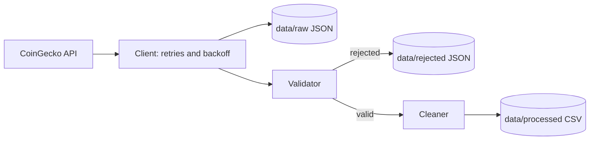

# Crypto Market Data Collector


A small, ETL pipeline in Python: it fetches market data for the top
cryptocurrencies from the CoinGecko API, validates and cleans it, and stores
timestamped snapshots as JSON and CSV.

> Built as a hands-on project to practice data-engineering fundamentals:
> API ingestion, retries, validation, cleaning, file storage, logging and testing.

## Features

- **Resilient API client**: timeouts, retries with exponential backoff, `Retry-After` support
- **Data validation**: type, range and cross-field checks; rejected records are saved with reasons
- **Quality gate**: the run stops if too many records are rejected (the API format may have changed)
- **Data cleaning**: UTC timestamps, normalized text and types, nulls are never turned into zeros
- **Safe storage**: atomic writes (no half-written files), raw data is always kept untouched
- **Observability**: rotating log files, a run summary, meaningful exit codes

## How it works



## Quick start

```bash
git clone https://github.com/ParsaKhadivpour/crypto-market-data-collector.git
cd crypto-market-data-collector

python -m venv venv
source venv/bin/activate        
pip install -r requirements.txt

cp .env.example .env            
python main.py
```

Requires Python 3.10+ and a free CoinGecko API key.

## Usage

```bash
python main.py                              # top coins with default settings
python main.py --limit 100 --currency eur   # 100 coins priced in EUR
python main.py --dry-run                    # run everything except writing files
python main.py --help
```

Exit codes: `0` success, `1` expected failure (API/data/disk), `2` invalid arguments, `3` unexpected error.

## Example output

```text
2026-10-15 16:57:34 | INFO     | main | Collector started (limit=50, currency=usd, dry_run=False)
2026-10-15 16:57:35 | INFO     | src.client | Fetched 50 coins (currency: usd)
2026-10-15 16:57:35 | INFO     | src.storage | Saved raw data: crypto-market-data-collector\data\raw\coins_20261015T125735Z.json (50 records)
2026-10-15 16:57:35 | INFO     | src.validator | Validation finished: 50 valid, 0 rejected
2026-10-15 16:57:35 | INFO     | src.cleaner | Cleaned 50 records (collected at 2026-10-15T12:57:35.579186+00:00)
2026-10-15 16:57:35 | INFO     | src.storage | Saved processed data: crypto-market-data-collector\data\processed\coins_20261015T125735Z.csv (50 records)
2026-10-15 16:57:35 | INFO     | src.pipeline | Run complete in 0.65s: fetched=50 valid=50 rejected=0 dry_run=False

Collected 50 coins in 0.6s (50 valid, 0 rejected)

1.Bitcoin (BTC: $80701.0)
2.Ethereum (ETH: $2351.93)
3.Tether (USDT: $0.999093)
4.BNB (BNB: $718.74)
5.XRP (XRP: $1.3)
6.USDC (USDC: $0.999613)
7.Solana (SOL: $101.81)
8.TRON (TRX: $0.329778)
9.Figure Heloc (FIGR_HELOC: $1.039)
10.Zcash (ZEC: $1085.7)
```


## Project structure

```text
src/
  cli.py          command-line interface
  pipeline.py     orchestrates the run
  client.py       CoinGecko client (retries, error translation)
  validator.py    data validation and quality gate
  cleaner.py      cleaning and normalization
  storage.py      atomic JSON/CSV writes
  models.py       CoinRecord dataclass
  config.py       settings from .env
  logger.py       logging setup
```

## Design decisions

- **Raw data is immutable and saved first**, so any cleaning bug can be fixed by reprocessing.
- **Validation decides, cleaning transforms**: the validator never modifies data.
- **Everything is UTC internally**; timestamps are stored as ISO 8601.
- **`None` is not `0`**: unknown values stay unknown.
- **Snapshots instead of one growing file**: every run is independent and nothing is overwritten.
- **Business logic never prints or exits**; only `main.py` talks to the terminal.

## Configuration

Copy `.env.example` to `.env`. See the file for all options (API key, currency,
log level, retry settings, rejection threshold).


## Data source

Market data provided by [CoinGecko](https://www.coingecko.com/).

## License

MIT, see [LICENSE](LICENSE).
